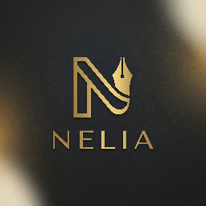
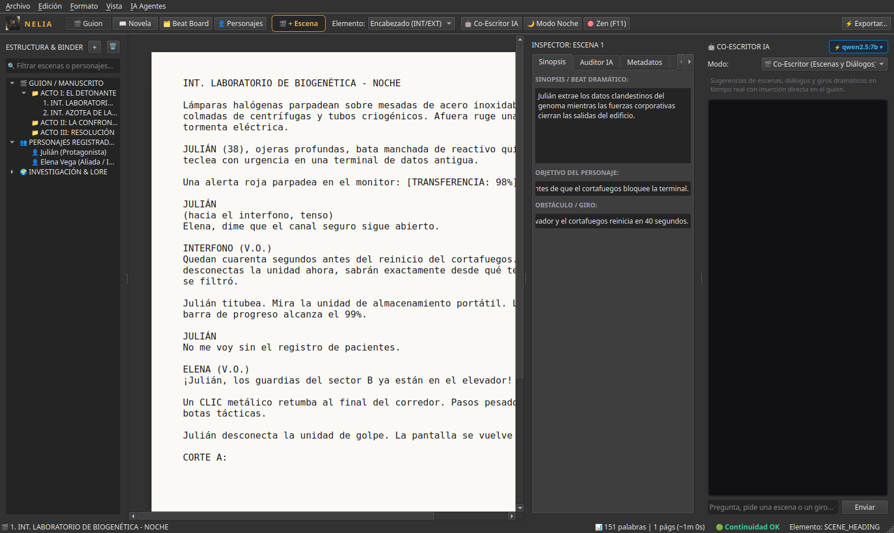

<p align="center">
  
</p>

<h1 align="center">NELIA — Suite de Escritura & Guion Cinematográfico</h1>

<p align="center">
  <b>Software de escritorio profesional para guionistas y novelistas, con co-escritura multi-agente local (Ollama) y persistencia robusta.</b>
</p>

<p align="center">
  
  
  
  
  
</p>

---



## ✨ Características Principales

### 🎬 Editor de Guion Estándar Hollywood
- **Formato Industrial Estricto**: Tipografía *Courier Prime 12pt*, márgenes de página industriales y paginación en tiempo real (55 líneas por página).
- **Flujo Dinámico por Teclado**: Transiciones contextuales automáticas entre `Encabezado de Escena (INT/EXT)`, `Acción`, `Personaje`, `Paréntesis`, `Diálogo` y `Transición` pulsando `Tab` y `Enter`.
- **Modo Noche en Papel (`Ctrl+D`)**: Alterna la visualización del lienzo entre hoja marfil clásica y modo oscuro para sesiones de escritura nocturnas.
- **Modo Concentración Zen (`F11`)**: Oculta todos los paneles secundarios y deja únicamente la página frente al autor.

### 📖 Modo Novela & Manuscrito
- Conmutador directo de espacio de trabajo para escribir prosa literaria fluida con indentación de párrafos y conteo dinámico de palabras y tiempo de lectura.

### 🗂️ Beat Board / Tablón de Corcho Interactivo
- Visualización de escenas mediante fichas indexadas.
- Agrupación por Actos y Secuencias, codificación de color por estado de revisión (`⚪ Primer Borrador`, `🟡 En Revisión`, `🟢 Pulido`, `🟣 Bloqueado`).

### 👤 Dossier Psicológico de Personajes
- Gestión profunda de personajes con campos estándar de dramaturgia:
  - **Deseo Consciente vs Necesidad Inconsciente** (*Want vs Need*)
  - **Defecto Fatal** (*Fatal Flaw*)
  - **Voz y Patrones de Diálogo** (*Cadencia, muletillas, léxico*)
  - **Arco de Transformación** (*Punto de partida, crisis y resolución*)

### 🤖 Co-Escritor Multi-Agente Local (100% Privado)
- **Privacidad Total**: Todo el procesamiento de IA corre en tu propia máquina mediante [Ollama](https://ollama.com/) y la librería `openai-agents`. Tu guion o novela nunca se envía a servidores de terceros.
- **Roles Especializados**:
  - **Co-Escritor**: Propone diálogos, acotaciones y escenas completas.
  - **Arquitecto de Tramas**: Analiza giros argumentales, promesas narrativas y relaciones entre personajes.
- **Inserción Directa en 1-Clic**: Si te gusta la escena o diálogo sugerido por la IA, un botón *"Mandar al Guion"* lo inserta inmediatamente en el manuscrito activo.
- **Selector Dinámico de Modelos**: Detecta automáticamente cualquier modelo que tengas descargado en Ollama (`qwen2.5:7b`, `llama3:8b`, `qwen2.5-coder:7b`, etc.) y te permite alternar entre ellos con un solo clic.

### 🔍 Auditor de Continuidad (Script Doctor)
- Analiza en segundo plano la coherencia física y temporal de la obra (horas del día, ubicaciones, objetos) y alerta sobre desviaciones en la voz de los personajes o agujeros de trama.

### 💾 Persistencia de Datos Híbrida (PostgreSQL + SQLite Fallback)
- **PostgreSQL 16**: Incluye configuración de Docker Compose para persistencia profesional multi-hilo.
- **Fallback Automático a SQLite**: Si no tienes Docker instalado o en ejecución, NELIA activa automáticamente una base de datos local SQLite (`nelia_local.db`) para que puedas escribir de inmediato sin ninguna configuración previa.

---

## 🚀 Inicio Rápido (Quick Start)

### En Linux / macOS
Simplemente clona el repositorio y ejecuta el lanzador inteligente (crea el entorno virtual e instala dependencias automáticamente):

```bash
git clone https://github.com/TU_USUARIO/nelia.git
cd nelia
./run.sh
```

### En Windows
Haz doble clic en `run.bat` o ejecútalo desde PowerShell / CMD:

```cmd
git clone https://github.com/TU_USUARIO/nelia.git
cd nelia
run.bat
```

---

## 🛠️ Instalación Manual Paso a Paso

Si prefieres configurar tu propio entorno manualmente:

### 1. Clonar el repositorio
```bash
git clone https://github.com/TU_USUARIO/nelia.git
cd nelia
```

### 2. Crear y activar el entorno virtual
```bash
python3 -m venv .venv

# En Linux/macOS:
source .venv/bin/activate

# En Windows:
.venv\Scripts\activate
```

### 3. Instalar dependencias
```bash
pip install --upgrade pip
pip install -r requirements.txt
```

### 4. Base de Datos (Opcional - Docker PostgreSQL)
Si tienes Docker instalado y deseas utilizar PostgreSQL:
```bash
docker compose up -d
```
*(Si no ejecutas Docker, la aplicación usará SQLite local de forma transparente).*

### 5. Motor de IA Local (Opcional - Ollama)
Para habilitar el Co-Escritor IA y la auditoría de continuidad:
1. Instala [Ollama](https://ollama.com/).
2. Descarga tu modelo de escritura preferido:
   ```bash
   ollama pull qwen2.5:7b
   # o bien: ollama pull llama3:8b
   ```
3. Inicia el servicio:
   ```bash
   ollama serve
   ```

### 6. Ejecutar la aplicación
```bash
python main.py
```

---

## ⌨️ Atajos de Teclado Útiles

| Atajo | Acción |
| :--- | :--- |
| `Ctrl+Shift+N` | Crear nueva escena personalizada a tu gusto |
| `Ctrl+J` | Mostrar / Ocultar panel del Co-Escritor IA |
| `Ctrl+D` | Alternar Modo Noche en hoja de papel |
| `F11` | Modo Concentración (Zen) a pantalla completa |
| `Tab` | Avanzar elemento dramático (Encabezado ➔ Acción ➔ Personaje ➔ Diálogo) |
| `Enter` | Confirmar elemento y pasar al siguiente bloque lógico |
| `Supr / Delete` | Eliminar escena o personaje seleccionado en el Binder |

---

## 📂 Estructura del Proyecto

```text
nelia/
├── assets/                 # Iconos oficiales, logo en alta resolución y recursos gráficos
├── ai/                     # Microservicio FastAPI y orquestación con openai-agents
│   ├── agents.py           # Definición de agentes (CoEscritor, Arquitecto, Auditor)
│   ├── config.py           # Configuración del endpoint Ollama y modelos
│   └── server.py           # Servidor local FastAPI (puerto 8765)
├── db/                     # Capa de base de datos y persistencia
│   ├── database.py         # Conexión resiliente (PostgreSQL + SQLite fallback)
│   ├── models.py           # Modelos SQLAlchemy (Project, Act, Scene, Character, Lore)
│   └── crud.py             # Operaciones CRUD completas
├── docs/                   # Capturas de pantalla e identidad de marca
│   └── screenshots/
├── styles/                 # Tema oscuro cinematográfico QSS (estilo DaVinci/Final Draft)
│   └── theme.py
├── widgets/                # Componentes interactivos PySide6
│   ├── binder.py           # Árbol de navegación y explorador de guion
│   ├── character_sheet.py  # Dossier y psicología de personajes
│   ├── corkboard.py        # Tablón de corcho / Beat board
│   ├── screenplay_editor.py# Editor de guion con auto-formato
│   ├── novel_editor.py     # Editor de novela y prosa
│   ├── inspector.py        # Inspector de metadatos de escena
│   ├── ai_chat_dock.py     # Panel de co-escritura con IA y selector de modelos
│   └── new_scene_dialog.py # Diálogo modal para añadir escenas personalizadas
├── docker-compose.yml      # Contenedor de PostgreSQL 16
├── run.sh                  # Lanzador y autoconfigurador para Linux / macOS
├── run.bat                 # Lanzador y autoconfigurador para Windows
├── requirements.txt        # Dependencias Python
└── main.py                 # Ventana principal y punto de entrada
```

---

## 📄 Licencia

Distribuido bajo la licencia MIT. Consulta el archivo `LICENSE` para más detalles.
